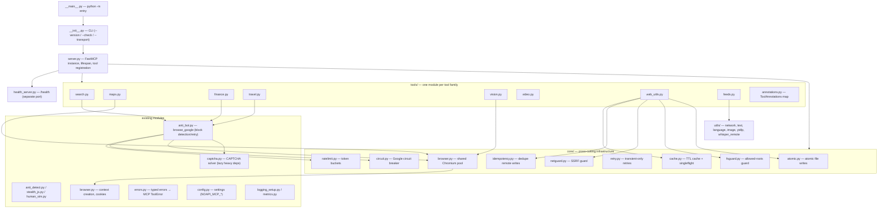

# Architecture

## Module layout



## Request lifecycle

Every Google-facing tool follows the same path. The ordering is deliberate:
cheap local checks first, the browser (the most expensive resource) last.

```
tool call
   │
   ├─ 1. Argument validation        MCP/FastMCP validates against the JSON schema
   │                                (enums for time_range / model_size, etc.)
   │
   ├─ 2. Read-through cache         @cached("<tool>") — exact-argument hit returns
   │       └─ singleflight          immediately; concurrent identical calls share
   │                                one in-flight execution
   │
   ├─ 3. Circuit breaker            open? → fail fast with the remaining cooldown
   │                                (never retried; cache hits still work)
   │
   ├─ 4. Rate limiter               token bucket for the host group; awaits a token
   │                                instead of hammering (all google.* share one)
   │
   ├─ 5. Browser pool               acquire a concurrency slot (MAX_BROWSERS) and a
   │                                fresh page from the shared Chromium context
   │
   ├─ 6. Scrape + block detection   browse_google: navigate, detect block/CAPTCHA,
   │                                retry, manual intervention if enabled
   │
   ├─ 7. Parse + format             extract results, resolve redirect URLs
   │
   └─ 8. Cache store                store only on success — never cache an error or
                                    a blocked result
```

Side-effecting tools (paste/shorten/archive/upload) replace steps 2/8 with the
**idempotency store** (reserve → do work → record result), so a retried call
returns the original outcome instead of performing the side effect twice.

## Concurrency model

- **One Playwright instance + one Chromium** are launched lazily on first use and
  owned by the FastMCP lifespan; shutdown closes them. A *fresh `BrowserContext`
  per call* keeps calls isolated.
- `MAX_BROWSERS` (default 3) caps concurrent contexts via an asyncio semaphore.
  A shared *persistent* context also avoids two Chromium instances contending for
  the same `user-data-dir` lock, which was a real cause of block storms when an
  LLM fired several searches at once.
- SQLite work (feeds, cache, idempotency) runs through `asyncio.to_thread`;
  feeds use WAL and per-worker connections, and `check_feeds` fetches sources
  concurrently with a bounded semaphore and per-source error isolation.
- Blocking libraries (`yt_dlp`, `faster_whisper`, `subprocess`) are called via
  `asyncio.to_thread` / `create_subprocess_exec`.

## Where state lives

| State | Location | Notes |
|---|---|---|
| Cache | `~/.cache/noapi-google-search-mcp/cache.db` (optional tier) | in-memory LRU always |
| Idempotency | `~/.cache/noapi-google-search-mcp/idempotency.db` | survives restarts |
| Feeds | `~/.cache/noapi-google-search-mcp/feeds.db` | `PRAGMA user_version` migrations |
| Transcripts / videos | `~/.cache/noapi-google-search-mcp/` | sha256 cache keys |
| Cookies | `~/.google_mcp_cookies.json` | written atomically, mode `0600` |
| Browser profile | `~/.config/google-mcp-browser` | persistent context |

## Design rules applied

- Backward compatibility first: new behaviour is additive (optional parameters,
  env flags); tool names, parameter names and defaults are unchanged.
- Heavy native imports (`cv2`, `numpy`, `onnxruntime`, `faster_whisper`,
  `yt_dlp`) stay inside functions so server startup and the common path stay light.
- Sending *fewer* upstream requests (cache, singleflight, rate limiting,
  conditional GET) is preferred over disguising requests better.
- Errors are raised as typed exceptions and converted to MCP `ToolError`
  (`isError: true`) with the original human-readable wording preserved.
- Logs go to **stderr only** — on the stdio transport stdout is the protocol
  channel (enforced by a test).
